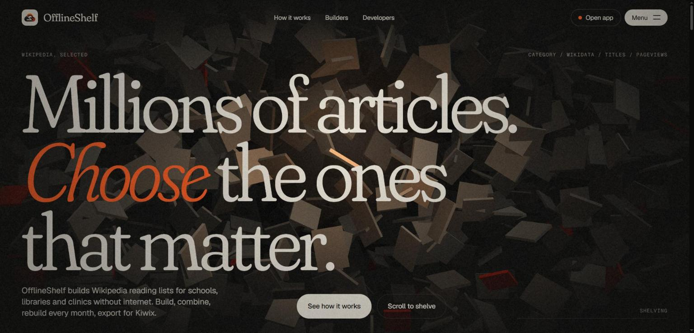
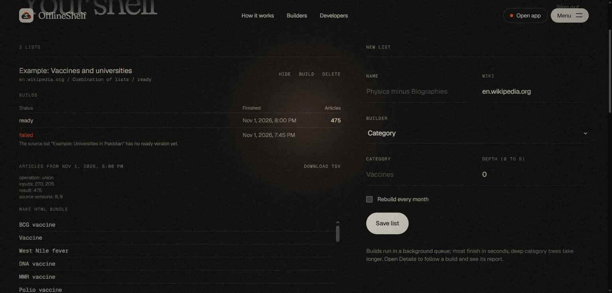
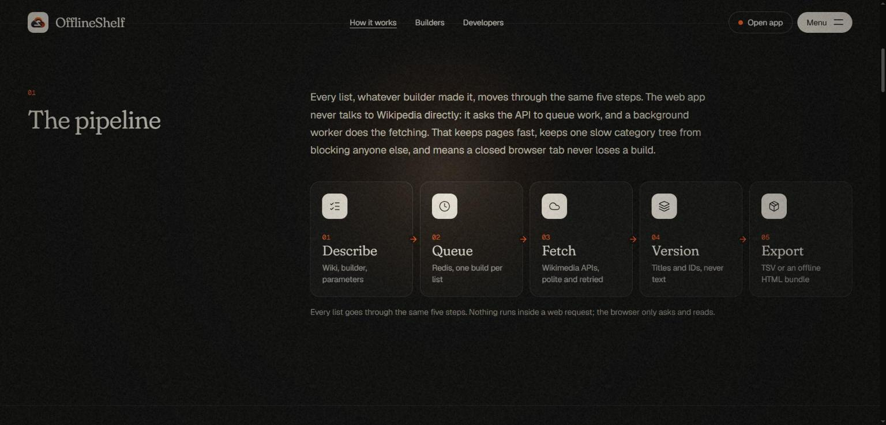
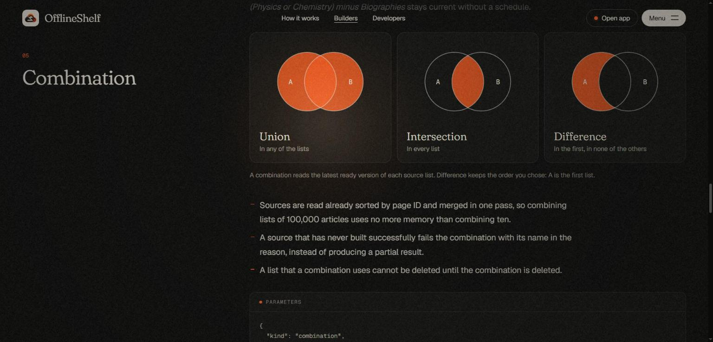
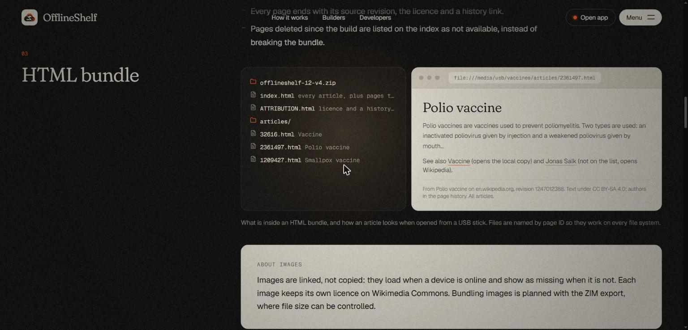
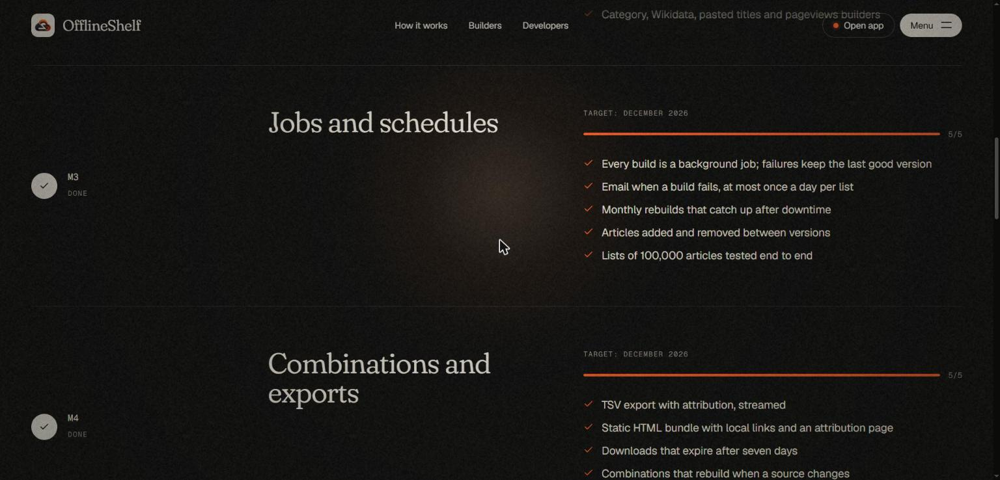

<div align="center">


# OfflineShelf

**Wikipedia reading lists for places without internet.**

Pick the articles, keep the list current, carry it anywhere: a USB stick, a school server, or Kiwix.

[](https://github.com/ahmershahdev/offlineshelf/actions/workflows/ci.yml)
[](LICENSE)
[](backend/pyproject.toml)
[](frontend/tsconfig.json)
[](https://creativecommons.org/licenses/by-sa/4.0/)

[Website](https://offlineshelf.ahmershah.dev) &middot;
[Guide](https://offlineshelf.ahmershah.dev/how-it-works) &middot;
[API](https://offlineshelf.ahmershah.dev/developers) &middot;
[Wiki](https://github.com/ahmershahdev/offlineshelf/wiki) &middot;
[Roadmap](docs/roadmap.md)

</div>



> **Status:** every builder, combinations, schedules, version changes and all three exports work
> end to end. Public launch at [offlineshelf.ahmershah.dev](https://offlineshelf.ahmershah.dev)
> in February 2027.

## Contents

- [What it does](#what-it-does)
- [Quick start](#quick-start)
- [How it works](#how-it-works)
- [Exports](#exports)
- [Development](#development)
- [Stack](#stack)
- [Documentation](#documentation)
- [Contributing and security](#contributing-and-security)
- [License](#license)

## What it does

OfflineShelf helps a school, library or clinic decide which Wikipedia articles to carry offline,
and keeps that decision reproducible.

| | |
|---|---|
| **Build** | From a category (breadth-first, loop-safe, depth 0 to 5), a Wikidata SPARQL query, a pasted list of titles (redirects followed, gaps reported), or the top articles by pageviews for a month. Any language of eight Wikimedia projects. |
| **Combine** | Union, intersection and difference of 2 to 10 lists, such as "Vaccines minus Companies". A combination rebuilds by itself when a source list changes. |
| **Keep current** | Every build is a version with a report and the articles added and removed since the last good one. Monthly rebuilds catch up after downtime. A failed build never replaces the last good version, and the owner gets one email a day at most. |
| **Export** | A streamed TSV, an HTML bundle that opens from a USB stick, or a ZIM file for the Kiwix apps. Every export carries the CC BY-SA attribution. |
| **Integrate** | Everything the app does goes through a documented JSON API ([OpenAPI](docs/openapi.yaml)). |



## Quick start

You need Docker with Compose v2.

```bash
git clone https://github.com/ahmershahdev/offlineshelf.git
cd offlineshelf
cp .env.example .env
# set OFFLINESHELF_SECRET_KEY and the two MariaDB passwords in .env. A key:
python -c "import secrets; print(secrets.token_urlsafe(48))"
docker compose up -d --build
```

Open <http://localhost:8080> and create an account. To add three example lists (a category, a
Wikidata query and their union) and build them:

```bash
docker compose exec api python -m app.seed you@example.org
```

| Setting | Where |
|---|---|
| Failure emails | `OFFLINESHELF_SMTP_*` in `.env` (any SMTP provider; the hosted instance uses Resend) |
| Limits, proxies, export expiry | [Self-hosting guide](https://offlineshelf.ahmershah.dev/self-host) and [docs/architecture.md](docs/architecture.md) |
| Prebuilt images | `ghcr.io/ahmershahdev/offlineshelf-api` and `offlineshelf-web`, published for every release |

## How it works



The web app only asks; a background worker does the fetching from the MediaWiki Action API, the
Wikimedia REST API and the Wikidata Query Service, with an identified User-Agent, `maxlag` and
backoff. Builds store titles, page IDs and revision IDs, never article text. A scheduler queues
monthly rebuilds, deletes expired exports and recovers builds whose worker stopped.



## Exports

| Format | What you get | For |
|---|---|---|
| **TSV** | Title, page ID and revision ID, streamed, with licence header lines | Spreadsheets, scripts, mwoffliner |
| **HTML bundle** | A zip with one page per article, local links, an index and an attribution page | USB sticks, school servers, a Raspberry Pi |
| **ZIM** | The same pages in one searchable file with Kiwix library metadata | Kiwix on phones, computers and hotspots |

HTML bundles and ZIM files hold up to 1,000 articles and expire after seven days; make a new one
from the same version and you get the same articles.



## Development

`npm run dev` from the repo root starts MariaDB and Redis in Docker, applies migrations, and runs
the Flask API and Vite with hot reload at <http://localhost:5173>. It needs
[uv](https://docs.astral.sh/uv/) and Node 24.

```bash
# backend: MariaDB and Redis from Compose, never SQLite, never live Wikimedia calls
cd backend
OFFLINESHELF_TEST_DATABASE_URL="mariadb+pymysql://offlineshelf:<MARIADB_PASSWORD>@127.0.0.1:3306/offlineshelf_test" uv run pytest --cov

# frontend
cd frontend && npm run lint && npm run typecheck && npm test
```



## Stack

| Part | Tools |
|---|---|
| API and jobs | Python 3.12, Flask, Pydantic 2, SQLAlchemy 2, Alembic, RQ (worker and cron scheduler), libzim |
| Data | MariaDB 11.4, Redis, MediaWiki Action API, Wikimedia REST API, Wikidata Query Service |
| Web | React, TypeScript (strict), Vite, Tailwind CSS; prerendered pages for SEO |
| Quality | pytest with recorded API responses, Vitest, Ruff, mypy (strict), ESLint, Prettier, CodeQL, Dependabot; `app/core` at 100% branch coverage |
| Run | Docker Compose: nginx, API, worker, scheduler, MariaDB, Redis |

## Documentation

| Document | Contents |
|---|---|
| [Wiki](https://github.com/ahmershahdev/offlineshelf/wiki) | Guides for users, self-hosters and contributors |
| [docs/architecture.md](docs/architecture.md) | API, data model, sources, builds, exports, security and every decision |
| [docs/core-contract.md](docs/core-contract.md) | The interface between the list logic and the rest |
| [docs/openapi.yaml](docs/openapi.yaml) | The JSON API |
| [docs/roadmap.md](docs/roadmap.md) | Milestones M1 to M6 and what "done" means |
| [docs/status.md](docs/status.md) | Current state, updated every session |

## Contributing and security

Read [CONTRIBUTING.md](CONTRIBUTING.md) to set up and send changes, and the
[code of conduct](CODE_OF_CONDUCT.md). Report vulnerabilities privately as described in
[SECURITY.md](SECURITY.md).

**Why it exists.** Picking a few thousand good articles out of millions is the hard part of
offline Wikipedia: the lists have to be reproducible, combinable and kept up to date. OfflineShelf
is a small, self-hostable tool for that step, built on the same ideas as Wikimedia's WP1 selection
tool, without needing its database replicas.

**Related:** [HolidayOps](https://github.com/ahmershahdev/holidayops) (business-day calendars) and
[MarketClock](https://github.com/ahmershahdev/marketclock) (trading days and settlement dates).

## License

Code: [MIT](LICENSE), &copy; 2026 [Syed Ahmer Shah](https://ahmershah.dev). Wikipedia text in
exports: [CC BY-SA 4.0](https://creativecommons.org/licenses/by-sa/4.0/); every export carries the
attribution it needs. Wikipedia is a trademark of the Wikimedia Foundation; OfflineShelf is
independent and not endorsed by the Foundation.
